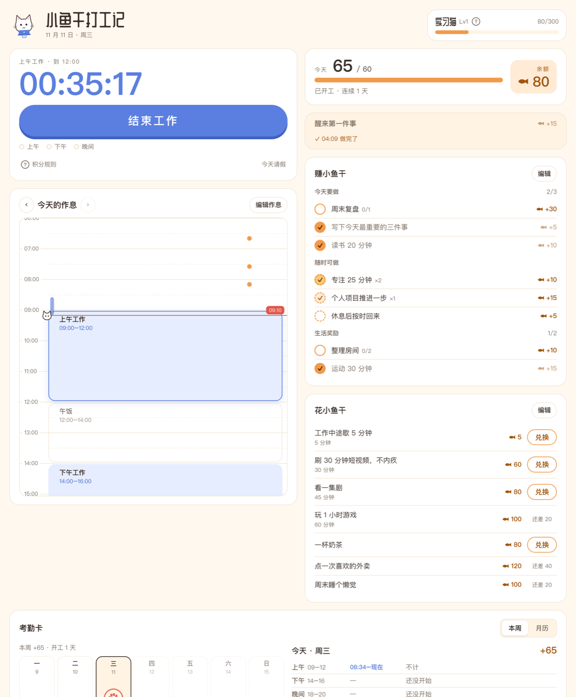

# 小鱼干打工记 · Fish for Work

一个给拖延的人用的 Mac 小工具。上下班打卡，做完事攒小鱼干，再用小鱼干换刷视频、奶茶、睡懒觉。

*A tiny macOS app for people who keep putting things off: clock in and out against your own schedule, earn "dried fish" points for getting things done, and spend them on guilt-free breaks. UI in Chinese.*



## 它能做什么

- **作息时间轴**：排好每天的工作、吃饭、运动时段。时间轴上能看到计划时段、实际打卡的工作时间和做完的事，一只小猫趴在“现在”这条线上。
- **上下班打卡**：准时上班、做满一段有奖励；迟到、早退、缺勤会扣分。点一次「开始工作」就一直计时，跨时段连着干也不用重新打卡。加班前 2 小时全额、之后减半，工作日每天最多算 4 小时，周末不封顶。分值都能改。
- **离开电脑自动停表**：键盘鼠标 30 分钟没动，工作记到你最后一次动电脑的时刻；回来时问你离开那段算不算工作。
- **请假**：按小时、按时段或整天请，可以提前请这周的，也能补请今天没在工作的时间。每周 4 小时内免费，超出按小时扣小鱼干。请假中途回来，没用完的额度会退回。
- **改记录**：忘了点结束，可以把当天的记录往早改；删错了当天还能恢复。
- **赚小鱼干**：任务分成「今天要做」（每天、每周几次、固定星期几）、「随时可做」和「生活奖励」。像“专注 25 分钟”这样的任务可以一天做好几次，圆圈的颜色会一层层变深。
- **花小鱼干**：用小鱼干兑换奖励。带计时的奖励（比如刷 30 分钟短视频）兑换后开始倒计时，到点没回来按分钟扣小鱼干。
- **开工线和连续天数**：每天攒够一定数量算“开工”，达标时会下一阵小鱼干雨。周末没达标不会断连续天数。
- **等级**：实习猫 → 正式猫 → 资深猫 → 猫组长 → 猫老板，小猫的配饰跟着等级换。
- **考勤卡**：按周、按月看哪天开工了（爪印），哪天没达标（鱼骨头）。
- **Mac 的部分**：菜单栏显示状态、上班前提醒、开机自动打开、本地 JSON 存档和每日备份。

## 安装

需要 macOS 13 或更新版本，以及 Xcode 命令行工具（`xcode-select --install`）。

```bash
git clone https://github.com/Miner-lala/fish-for-work.git
cd fish-for-work
./build.sh --install
```

这会编译 App，装到 `/Applications/小鱼干打工记.app`，然后打开它。不带 `--install` 只生成 `build/小鱼干打工记.app`。

## 只想在浏览器里看看

直接用浏览器打开 `Resources/index.html` 就能用。这时数据存在浏览器的 localStorage 里。

## 数据存在哪

- 记录：`~/Library/Application Support/XiaoYuGan/data.json`
- 每天一份备份，留最近 30 天：同目录下的 `backups/`

重新打包、更新 App 都不会动这些文件。

## 项目结构

```
Resources/index.html   整个界面和积分逻辑（单个 HTML 文件，无依赖）
Sources/XiaoYuGan/     Mac 外壳：窗口、菜单栏、提醒、开机启动、存档（Swift + WKWebView）
tools/make_icon.swift  生成 App 图标
build.sh               编译、打包、安装
```

## License

[MIT](LICENSE)
